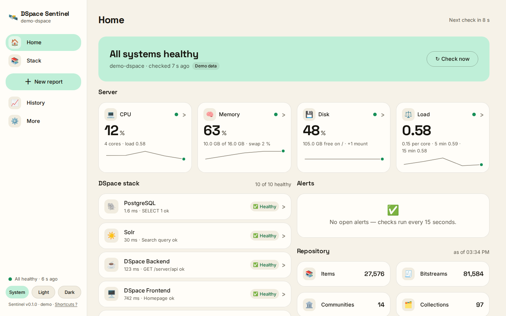
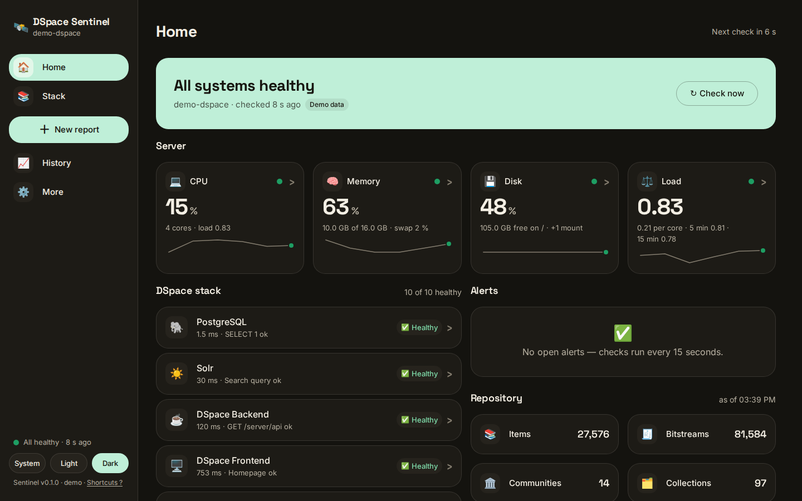
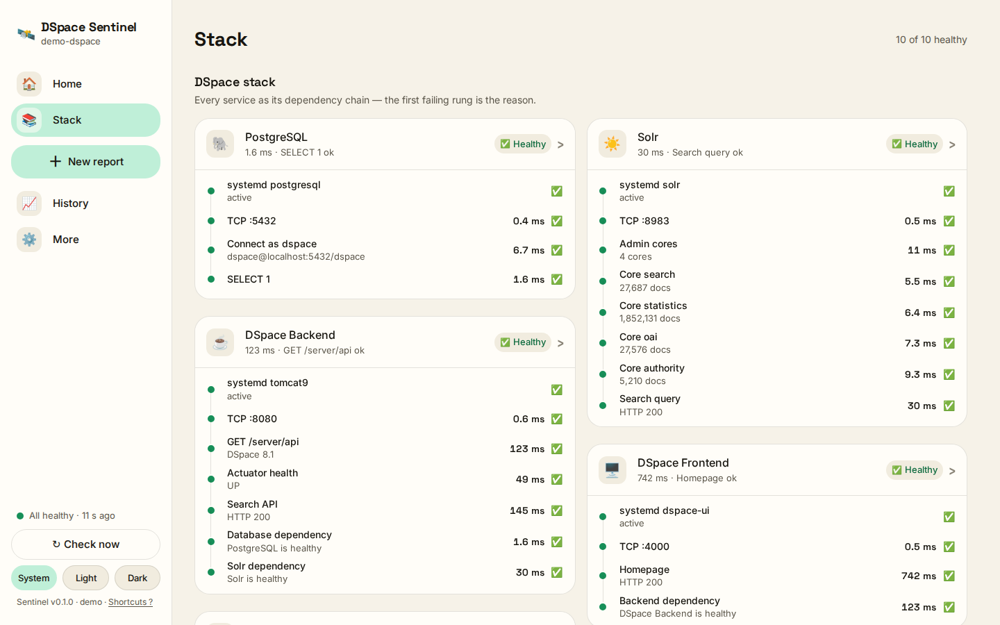
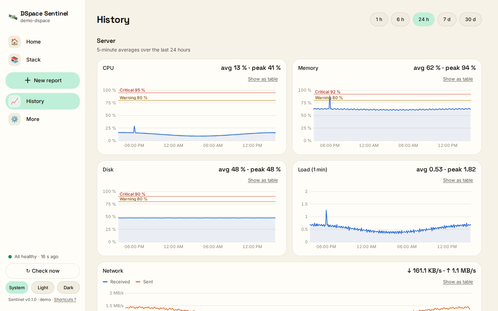
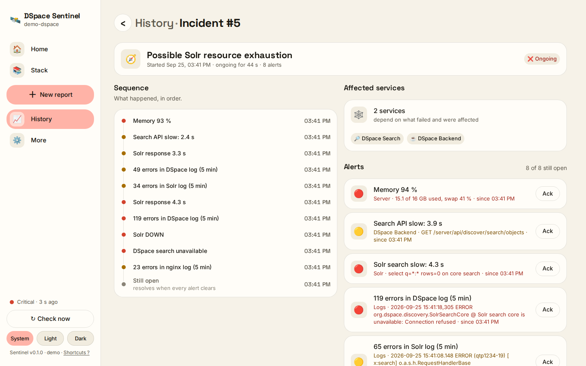
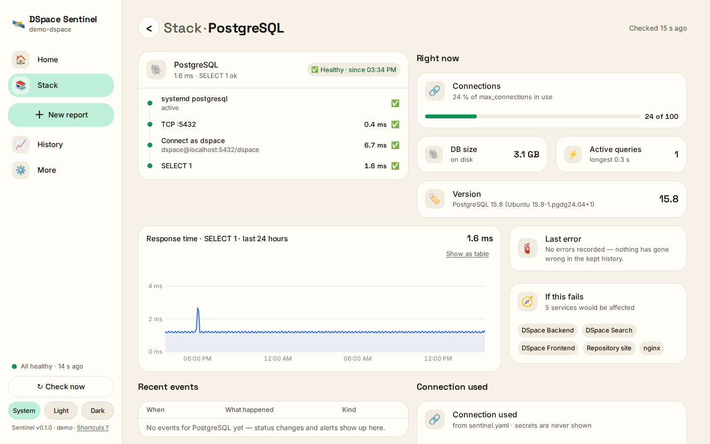
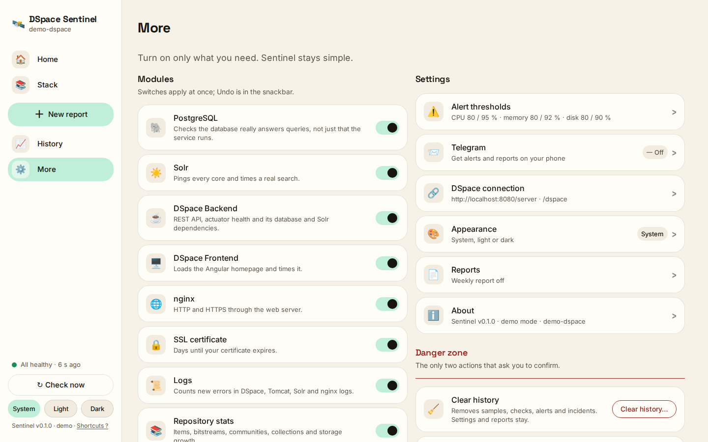
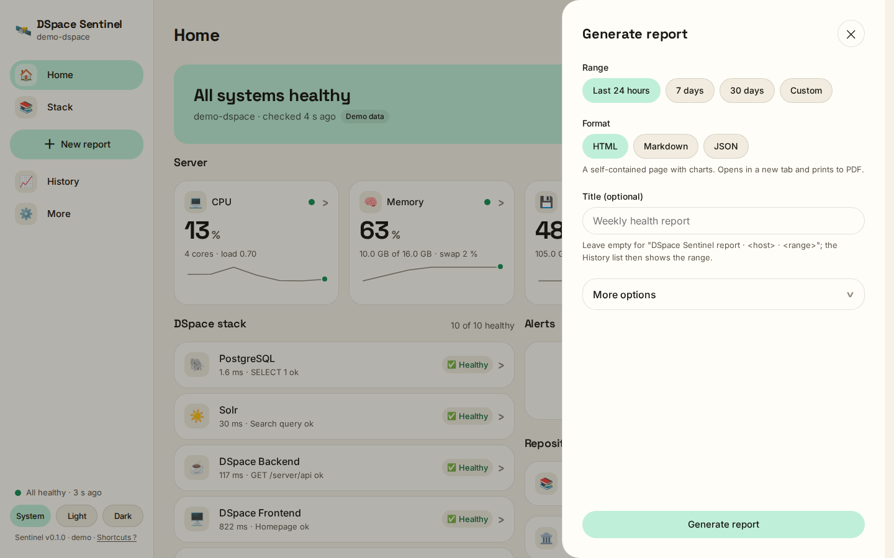

# 🛰️ DSpace Sentinel

**A lightweight, observe-only health dashboard for DSpace 7, 8 and 9 servers — with
dependency-aware checks, a read-only security check, Telegram and email alerts, incident
correlation and weekly reports. One command to install, no build step.**

[](https://github.com/Danindu05/dspace-sentinel/actions/workflows/ci.yml)
[](LICENSE)
[](pyproject.toml)
[](docs/COMPATIBILITY.md)

```
┌────────────────────────────────────────────────────────────────────────────┐
│ 🛰️ DSpace Sentinel v0.1.0               demo-dspace · 2026-09-29 19:37 UTC │
│ ✅ All systems healthy                         demo data · checked 0 s ago │
├─ SERVER ───────────────────────────────────────────────────────────────────┤
│ ✅ CPU 17 %   ✅ Memory 63 %   ✅ Disk 48 %   ✅ Load 0.55 / 4 cores       │
│    ✅ swap 2 % · 10.0 GB of 16.0 GB used · rx 211.3 KB/s · tx 1.2 MB/s     │
│    inodes 12 %                                                             │
│    Ubuntu 24.04 · kernel 6.8.0-45-generic · up 17 d 3 h · / 48 % used      │
│    ✅ /dspace 41 % used · 603.6 GB free of 1024.0 GB                       │
├─ DSPACE STACK ─────────────────────────────────────────────────────────────┤
│ ✅ PostgreSQL       1 ms          24 / 100 connections · db 3.1 GB · Post… │
│    service ✅ → TCP ✅ → connect ✅ → query ✅                             │
│ ✅ Solr             200 / 28 ms   6 cores · 27 687 docs · Solr 9.6.1       │
│    service ✅ → TCP ✅ → admin ✅ → cores 6/6 ✅ → search ✅               │
│ ✅ DSpace Backend   200 / 118 ms  DSpace 9.4 · Demo Institutional Reposit… │
│    service ✅ → TCP ✅ → rest ✅ → actuator ✅ → search ✅                 │
│    dep.postgres ✅ → dep.solr ✅                                           │
│ ✅ DSpace Frontend  200 / 687 ms  Demo Institutional Repository            │
│    service ✅ → TCP ✅ → home ✅ → dep.backend ✅                          │
│ ✅ Repository                                                              │
│    27 576 items · 81 584 bitstreams · 14 communities · 97 collections      │
│    db 3.1 GB · assetstore 420.4 GB                                         │
│ ✅ Assetstore                                                              │
│    /dspace/assetstore · 603.6 GB free of 1024.0 GB · 41 % used             │
│    growing 1.2 GB/day                                                      │
│ ✅ Logs                                                                    │
│    dspace 2 err ✅ · tomcat 0 err ✅ · solr 1 err ✅ · nginx 0 err ✅      │
│    (5 min window)                                                          │
├─ NETWORK ──────────────────────────────────────────────────────────────────┤
│ ✅ nginx            200 / 4 ms    nginx/1.24.0                             │
│    service ✅ → http ✅                                                    │
│ ✅ SSL certificate  42 ms         61 days left                             │
│    repo.demo-dspace.org · R11 (Let's Encrypt) · expires 2026-11-29         │
│ ✅ Ports                                                                   │
│    22 SSH ✅ · 80 HTTP ✅ · 443 HTTPS ✅ · 4000 Angular ✅                 │
│    8080 Backend ✅ · 8983 Solr LOCAL ONLY ✅                               │
│    5432 PostgreSQL LOCAL ONLY ✅                                           │
│ ✅ Security                                                                │
│    ports ✅ · firewall ✅ · ssh ✅ · web ✅ · updates ✅ · software ✅     │
│    files ✅ · sentinel ✅                                                  │
├─ ALERTS ───────────────────────────────────────────────────────────────────┤
│ ✅ No open alerts                                                          │
└────────────────────────────────────────────────────────────────────────────┘
```

That is `./sentinel.sh doctor --demo`; on your own server `./sentinel.sh doctor` draws the same box
(`--ascii` for plain ASCII, `--json` for the raw status); the time in its top row names its zone
(`server.timezone`, see [Telegram and email](#telegram-and-email-alerts)). The web UI tells the same
story with tiles, ladders and charts:

<!-- screenshots: demo mode at 1440×900. Refresh with SENTINEL_E2E=1 SENTINEL_E2E_SHOTS=docs/screenshots .venv/bin/python -m pytest tests/e2e; incident.png is captured by hand (docs/DESIGN.md). -->
| Home (light) | Home (dark) |
|---|---|
|  |  |

| Stack — dependency ladders | History — charts and availability |
|---|---|
|  |  |

| Incident — the story of the scripted Solr outage | PostgreSQL — one service in depth |
|---|---|
|  |  |

| More — modules and settings | ＋ New report |
|---|---|
|  |  |

Desktop first: at [1920 px](docs/screenshots/home-wide.png) the grid uses the width; below
900 px the sidebar becomes a [bottom bar](docs/screenshots/home-narrow.png). Telegram gets the
same story as plain text, and email as a message with the same facts:

```
🧭 INCIDENT #5 · demo-dspace
Possible Solr resource exhaustion

18:03 UTC  Memory 94 %
18:05 UTC  Solr response 4.8 s
18:07 UTC  Solr DOWN
18:07 UTC  DSpace search unavailable

Affected: DSpace Search, DSpace Backend
```

---

## Why not Netdata or Uptime Kuma?

Both are excellent, and neither knows what a DSpace server *is* out of the box. You can
hand-build HTTP and keyword checks for the REST API, `discover/search/objects` and each Solr core,
but you still get a wall of independent red squares instead of one chain that says *why*.
Sentinel reads `local.cfg`, needs no per-check setup and checks the things a repository manager
actually worries about — *does PostgreSQL answer a query as the `dspace` user, does every Solr
core ping, does the REST API report a DSpace version, does the Angular homepage load, how many
days are left on the certificate, how fast is the assetstore filling up*. It explains failures as
a chain, so "Backend degraded" reads `service ✅ → TCP ✅ → REST ✅ → Search ❌ · Solr dependency ⚠️`,
and it groups alerts that belong together into one incident with a likely cause. It runs next to
DSpace on the same box in under 150 MB, never writes to anything it monitors, and needs no
Prometheus, Grafana, Docker or Node.

## What it checks

Everything except the server module is **off by default**; switch on what runs on the box. The
first-run wizard pre-selects Security for every kind of server, since it looks at the server
itself.

| Module | Emoji | What is checked | Metrics |
|---|---|---|---|
| **Server** (always on) | 💻 | CPU, memory, swap, disk on `/` and every extra mount (assetstore), inodes, load per core, network rate, uptime, OS, kernel | thresholds on all of them, 12-point sparklines |
| **PostgreSQL** | 🐘 | `systemd postgresql` → `TCP :5432` → connect as `dspace` → `SELECT 1` (read-only session, 3 s statement timeout) | connections / max, DB size, version, active queries, longest query |
| **Solr** | ☀️ | service → TCP → `admin/cores` → ping of every configured core (plus the optional `qaevent`, `suggestion` and `audit` cores when Solr has them; a core that failed to load says why) → timed `select?q=*:*&rows=0` on `search` | per-core docs and size, version, search latency |
| **DSpace Backend** | ☕ | service → TCP → `GET /server/api` (DSpace version) → actuator health, graded the way your DSpace version defines it → `discover/search/objects` → PostgreSQL and Solr dependency rungs | REST and search latency, DSpace version and name, actuator status |
| **DSpace Frontend** | 🖥️ | service → TCP → Angular homepage (`<ds-app>`, asked as the public host so DSpace 9.3+ renders it on the server) → public URL through nginx/TLS → backend dependency | home and public latency, page title, server-side or client-side rendering |
| **nginx** | 🌐 | service → HTTP → HTTPS (the web server in front of DSpace; with none on the box, switch it off) | latencies, `Server` header |
| **SSL certificate** | 🔒 | certificate of the public host | days left, expiry, issuer, subject, SANs |
| **Ports** | 🔌 | expected ports open; Solr and PostgreSQL *local only* (warn when they listen on every interface, `0.0.0.0` or `::`, with a hint on how to close or accept it) | listening sockets and their addresses |
| **Security** | 🛡️ | open ports, firewall, SSH, updates and software support: read-only. Ports other machines can reach that no rule expects (and the ones opened since Sentinel started; a port that only Tailscale's network reaches reads *Tailscale*, not unexpected), the host firewall (ufw, nftables, firewalld), SSH root and password login, HTTPS and security headers on the public address, pending security updates and a required reboot, end of support of DSpace, Solr, PostgreSQL and the OS, who may read `local.cfg` and Sentinel's own configuration, and how Sentinel itself listens (and whether the dashboard login or a token guards it), with a hint on what to do for most warnings | every listening port with its verdict (expected, local, Tailscale, exposed, new), software versions with the day their support ends |
| **Logs** | 📜 | new errors in `dspace.log` (and its daily files), `catalina.out` (packaged Tomcat's format included), `solr.log`, nginx `error.log`, and `dspace-cli.log` when discovery finds it (tail only, 5-minute window) | errors, warnings, last error line |
| **Repository** | 📚 | items, bitstreams, communities, collections, epersons, workflow items, DB size, assetstore bytes (DB first, REST fallback) | 30-day growth per day |
| **Assetstore** | 🗄️ | assetstore path readable, mount usage | free GB, growth per day, days until full |
| **Incidents** | 🧭 | groups alerts opened within five minutes into one incident with a hypothesis | affected services, timeline |

It works with **DSpace 7 (end-of-life), 8 and 9**: under Tomcat 9, Tomcat 10 or the runnable JAR,
with Solr 8 or 9, anonymously, with no change on the DSpace side. What differs between the versions
and what Sentinel does about it is in [docs/COMPATIBILITY.md](docs/COMPATIBILITY.md).

## Ladders: health as a dependency chain

Every service is checked as a ladder of rungs, in order. The first failing rung is the reason;
everything below it is *not reached*, not "down". A rung that answered correctly but too slowly
is graded on its latency and does not stop the rungs below it.

```
PostgreSQL 🐘                        DSpace Backend ☕
  systemd postgresql   ✅ active        systemd tomcat10       ✅ active
  TCP :5432            ✅ 0.5 ms        TCP :8080              ✅ 0.8 ms
  Connect as dspace    ✅ 6 ms          GET /server/api        ✅ 123 ms   DSpace 9.4
  SELECT 1             ✅ 1.2 ms        Actuator health        ✅ 49 ms    UP
                                        Search API             ❌ HTTP 500: Solr unreachable
                                        Database dependency    ✅ PostgreSQL is healthy
                                        Solr dependency        ⚠️ Solr is down (Critical): connection refused
```

The DSpace chain is modelled explicitly: `backend → [postgres, solr]`, `frontend → [backend]`,
`nginx → [frontend]`. A dependency rung mirrors the dependency's status but is **capped at warn**,
so a dead Solr makes the backend *degraded* (search is broken) rather than *down* (the REST API
still answers). A Solr that answers correctly but past its critical latency reads "Solr is slow
(Critical): search took 4.3 s" in that rung, never "down". A rung that only says something is not
available on this host — no actuator endpoint, no such systemd unit, a log file that is not there —
stays in the ladder as "— not available" and never counts against the service. On a service's
page a rung can also carry a hint, a line that says what to do: which group lets Sentinel read a
log, how to close or accept a port, that there is no web server to check. The mood of the whole
dashboard is the worst enabled component *and* any open alert: mint when healthy, butter on
warnings, coral on a critical, sky before the first check and whenever the page loses contact with
Sentinel or checks are overdue (it then shows the last known state, greyed out).

## Quick start (60 seconds)

Requirements: Linux, Python 3.10+, `python3-venv`. Run everything as your normal user:
`./sentinel.sh install` refuses to run under `sudo`, and `--service` asks for sudo only to install
the systemd unit.

```bash
git clone https://github.com/Danindu05/dspace-sentinel.git
cd dspace-sentinel
./sentinel.sh install        # venv, dependencies, config/sentinel.yaml, the dashboard login, discovery of your DSpace
./sentinel.sh start          # background process (or: ./sentinel.sh install --service for systemd)
```

On the way, `install` asks you to **create the dashboard login** ("Create the dashboard login"):
a username (Enter keeps `admin`) and a password of at least 12 characters, typed twice and never
shown. Skip it with `./sentinel.sh install --no-login`. When `install` does not run on a terminal
(CI, a script, Ansible) it never asks and prints `No dashboard login yet: run ./sentinel.sh
set-password` instead; run that command later to create it.

Open **http://localhost:9765** and sign in. The first-run wizard asks what runs on this server
(full stack, backend only, frontend only, just the server), shows what it found in `local.cfg`,
and starts monitoring (nginx and SSL only when it finds a web server and HTTPS, so a DSpace opened
directly on :4000 does not start with a false nginx alert; Security for every kind of server).
Sentinel binds to `127.0.0.1` only; from your laptop use an SSH tunnel
(`ssh -L 9765:127.0.0.1:9765 repo-1`, then open http://localhost:9765 and sign in there) or the
[nginx HTTPS recipe](docs/REVERSE-PROXY.md). It reads DSpace's `local.cfg` and log files as the user it
runs as, so that user needs read access to them (usually membership of the group that owns them,
such as `adm` or the Tomcat group). After adding the group, log out and in again before you
restart Sentinel: a process started from a shell that was open before keeps the old groups. The
Logs page names the owner, group and mode of a file it may not read; see the
[FAQ](docs/FAQ.md#setup).

```bash
./sentinel.sh doctor         # one-shot boxed dashboard; exit 0 ok, 1 warnings, 2 critical
./sentinel.sh status         # is it running?
./sentinel.sh logs           # the journal, or data/sentinel.log without a systemd unit
./sentinel.sh report --range 7d --format html
```

`sentinel.sh` works from any directory and through a symlink (for example
`sudo ln -s "$PWD/sentinel.sh" /usr/local/bin/sentinel`). Exit codes are the same for every
command: 0 ok · 1 warnings or not running · 2 critical (`doctor`) · 3 not available in this
build · 4 the command could not run (not installed yet, no suitable Python, a broken config, a
report that could not be sent) · 64 usage error · 130 interrupted.

### The dashboard login

With a login set (`server.login` in `config/sentinel.yaml`), the web UI opens on **Sign in to
DSpace Sentinel**: username, password and *Keep me signed in for 30 days*. Nothing else loads
until you sign in. A session ends after 12 hours without use and at the latest 7 days after
signing in (30 days with *Keep me signed in*), when you click **Sign out** at the foot of the
sidebar (or on **More › Account** in the narrow layouts), and when the password changes; the page
then says "Your session ended. Sign in again." and returns you to where you were. **More ›
Account** changes the password: other browsers are signed out, yours stays signed in. After five
wrong passwords from one address within 15 minutes each further try has to wait, 1 s at first and
twice as long after every miss up to 5 minutes (the button counts down "Try again in 16 s"), and
twenty wrong passwords for one username within 15 minutes lock it for 15 minutes. There is one
account; demo mode never asks for it.

| Command | What it does |
|---|---|
| `./sentinel.sh set-password` | create or change the login: the username (`admin`, or the current one, on Enter), then the password twice, hidden. Prints "Login saved for 'admin'. Sessions that were signed in have been signed out." A running Sentinel picks it up within seconds, no restart |
| `./sentinel.sh set-password --user NAME --password-stdin` | the same without questions: the password is one line of standard input (scripts) |
| `./sentinel.sh set-password --remove` | remove the login, so the dashboard stops asking (asks first; `--yes` skips the question). Refused while Sentinel listens on another address than `127.0.0.1` with no `server.auth_token`, because it would then refuse to start |
| `./sentinel.sh hash-password` | print only the hash of a password (asked twice), for `dspace_sentinel_login_password_hash` of the [Ansible role](docs/ANSIBLE.md) |

Forgot the password? Run `./sentinel.sh set-password` on the server; there is no email reset.
`status`, `doctor`, `report` and `discover` keep working with a login set (`status` asks the
running Sentinel with a private token it writes to `data/api-token` at every start). Scripts that
call the API use `server.auth_token` as a token: `curl -H "Authorization: Bearer $TOKEN"
http://127.0.0.1:9765/api/status` ([API.md](docs/API.md#conventions)). More questions:
[FAQ](docs/FAQ.md#the-dashboard-login).

### Try it without a DSpace: demo mode

```bash
./sentinel.sh demo           # http://localhost:9765 with a synthetic DSpace 9.4 stack
```

Demo mode swaps every collector for a scripted DSpace 9.4 stack (`demo-dspace`, about 27 600
items and 81 600 bitstreams, Tomcat 10, Solr 9 with six cores) with seven days of back-filled
history and an incident every twenty minutes: memory climbs, Solr slows down, Solr goes down,
search fails, then everything recovers — so alerts, incidents, Telegram and email messages
(logged, never sent) and reports all have data. Its Security page shows the demo server
(DSpace 9.4, Ubuntu 24.04, Tomcat 10) with every check ok and two hints: SSH still accepts
passwords, and the public address sends no `Strict-Transport-Security` header; the program
names in its open-ports table are empty, as on a real server where Sentinel runs as its own user.
The demo keeps its database in `data/demo/`. Whatever you change in the demo (onboarding, modules,
thresholds, theme) is saved to `data/demo/demo-sentinel.yaml` (next to the demo database in
`SENTINEL_DATA_DIR` when you set one), never to your real `config/sentinel.yaml`; delete that file
to start over. `SENTINEL_DEMO_FAST=1` compresses the live cycle to three minutes with checks every
5 s. The demo never asks for the dashboard login.

## Telegram and email alerts

Up to five people can each get the alerts from their own Telegram bot, and up to five addresses
by email; a JSON webhook covers anything else. Each channel has its own switch, and deliveries
run in the background, so a slow Telegram or mail server never delays a check.

**Telegram, one bot per person.**

1. Each person opens **@BotFather** in Telegram, sends `/newbot`, follows the prompts and copies
   the token it answers with (`123456789:AAH4x…`).
2. They open their new bot and send it any message (for a group: add the bot and mention it
   once).
3. They get their chat id, for example from **@userinfobot** (a group's id starts with a minus).
4. In **More › Telegram**, switch **Send alerts to Telegram** on, add one row per person (their
   bot's token, their chat id, **All alerts** or **Critical only**; up to five), click **Save
   changes**, then **Send test message**. Each bot sends "👋 DSpace Sentinel is connected" and
   its row says whether it arrived.

**Email through Gmail.**

1. Turn on 2-Step Verification for the Gmail account Sentinel will send from, then create an app
   password at Google Account › Security › 2-Step Verification › App passwords, signed in to that
   same account. Google shows 16 letters once.
2. In **More › Email**, switch **Send alerts by email** on, keep **Gmail**, enter the Gmail
   address and paste the 16 letters (never the account's normal password: Gmail refuses it), add
   up to five recipients, click **Save changes**, then **Send test email**.

Any other mail server or relay works too: choose **Other SMTP server** (STARTTLS on port 587,
SSL/TLS on 465). Alerts, incidents, digests and reports only go out while a channel's switch is
on; the tests are sent regardless, so a working test proves only that this machine can reach the
bot or the mailbox.

Once saved, a token or password shows as dots, with "Saved. Hidden for safety — type a new one to
replace it." under it: it is stored, just never sent back to the browser. When a test fails, its
row says why and what to check ("api.telegram.org did not answer within 10 s: this server may not
be able to reach Telegram …", "Gmail refused the login for … (535 5.7.8 Username and Password not
accepted): …").

Secrets can stay out of `config/sentinel.yaml`: put them in `config/sentinel.env` (`KEY=VALUE`
lines, git-ignored), which every `./sentinel.sh` command and the systemd unit read. Saving from
the UI never copies its values into the YAML:

```bash
cat >> config/sentinel.env <<'EOF'
SENTINEL_SMTP_PASSWORD='abcd efgh ijkl mnop'
SENTINEL_TELEGRAM_TOKEN='123456789:AAH4x…'
SENTINEL_TELEGRAM_CHAT_ID='987654321'
EOF
chmod 600 config/sentinel.env
./sentinel.sh restart                          # the running Sentinel reads the file when it starts
./sentinel.sh telegram-test                    # a test message through every bot
./sentinel.sh telegram-test --to 987654321     # one bot, by its chat id (or its row id)
./sentinel.sh email-test                       # one test email to every recipient
./sentinel.sh report --range 7d --email        # a 7-day report, emailed as an attachment
```

`SENTINEL_SMTP_PASSWORD` is the email app password. The Telegram pair adds one more bot, shown
read-only in **More › Telegram** as "From environment". The tests print one line per bot or
recipient and exit 4 when any of them failed.

Messages are short and mobile-friendly; the email for the same alert has the subject
"[Sentinel] CRITICAL · repo-1 · PostgreSQL unreachable" and the same facts:

```
🔴 CRITICAL · repo-1
PostgreSQL unreachable
service ✅ → TCP ✅ → connect ❌
connection refused (localhost:5432)

Started 10:43 UTC · DSpace Sentinel
```

Every time Sentinel sends names its zone: "Started 21:29 +0530", "15:59 UTC". It is the zone of
`server.timezone`, chosen in **More › Alert thresholds › Time zone** (an IANA name such as
`Asia/Colombo`; empty = the server's own zone), which also sets the clock that quiet hours, the
daily digest and the weekly report follow. The dashboard itself shows your browser's time.

Who gets what (**All alerts** or **Critical only**), quiet hours for each channel (`23:00-07:00`
→ only critical), daily digests, reminders, the webhook and what every error message means are in
[docs/NOTIFICATIONS.md](docs/NOTIFICATIONS.md); the alert rules are in
[docs/ALERTS.md](docs/ALERTS.md).

## Configuration

One YAML file, `config/sentinel.yaml`, copied from
[`config/sentinel.example.yaml`](config/sentinel.example.yaml) on install. The UI edits it
through the API (validated, written atomically with mode 0600, applied without a restart); you can
also edit it by hand and restart. Saving from the UI rewrites the whole file without comments, so
keep your notes elsewhere, or make every change by hand and restart. Server settings
(`server.*`: address, port, auth token, the login, allowed host names) are only changed in the
file, except `server.timezone` (the zone of the times Sentinel sends), which **More › Alert
thresholds** may change too, and the dashboard login, which `./sentinel.sh set-password` writes
(it rewrites the file like a save from the UI) and **More › Account** changes the password of.

Environment variables win over the file and are never written into it: `SENTINEL_PORT`,
`SENTINEL_HOST`, `SENTINEL_CONFIG`, `SENTINEL_DATA_DIR`, `SENTINEL_AUTH_TOKEN`,
`SENTINEL_PG_PASSWORD`, `SENTINEL_SMTP_PASSWORD`, `SENTINEL_DEMO`, and
`SENTINEL_TELEGRAM_TOKEN` + `SENTINEL_TELEGRAM_CHAT_ID` (one more Telegram bot).
Keep secrets in `config/sentinel.env` (`KEY=VALUE` lines, `chmod 600`, git-ignored): every
`./sentinel.sh` command and the systemd unit read it, and variables already set in the
environment win.

```yaml
modules:                     # everything off by default; server is always on
  postgres: true
  solr: true
  backend: true
  frontend: true
alerts:
  disk: {warning: 80, critical: 90}
  rest_latency_ms: {warning: 1000, critical: 3000}
notifiers:
  telegram:
    enabled: true
    chats:                   # up to 5 bots, one per person
      - {label: Danindu, bot_token: "123456789:AAH4x…", chat_id: "987654321", min_severity: warning}
    quiet_hours: "23:00-07:00"
  email:
    enabled: true
    username: sentinel.repo1@gmail.com          # its app password: SENTINEL_SMTP_PASSWORD
    recipients: [{address: ops@example.org, min_severity: critical}]
```

Every key, its default and what it does: [docs/CONFIG.md](docs/CONFIG.md).

## Reports

Click **＋ New report**, keep the preselected range, click **Generate report**. Two clicks.
Reports are self-contained HTML (one file that makes no external requests and prints cleanly to
PDF), Markdown or JSON and contain a health score, availability per service, CPU/memory/disk
percentiles, REST/search/homepage latency percentiles, alerts and incidents, repository growth
(items, bitstreams, assetstore, days until the disk is full), the Security findings with their
hints, open ports and software support, and recommendations. A weekly report
can be scheduled (it runs from the scheduler of a running Sentinel) and sent to Telegram and by
email, and any report can be sent the same way from the panel or with `report --telegram` /
`report --email`. Details: [docs/REPORTS.md](docs/REPORTS.md).

## Incident correlation

With the **Incidents** module on, alerts that open within five minutes of each other become one
story instead of five pings:

```
🧭 INCIDENT #24 · repo-1
Possible Solr resource exhaustion

10:41 UTC  Memory 94 %
10:42 UTC  Solr response 4.8 s
10:43 UTC  Solr DOWN
10:43 UTC  DSpace search unavailable

Affected: DSpace Search, DSpace Backend
```

The hypothesis comes from a small table of signatures (disk + PostgreSQL → "Disk pressure
affecting PostgreSQL", backend down + frontend down → "Backend outage: the UI cannot reach the
REST API", …) and the affected list is the dependency closure. The incident resolves when its
last alert resolves, with one closing message stating the duration.

## Architecture

```
                 ┌──────────────────────────── dspace-sentinel (one Python process) ───────────────────────────┐
                 │                                                                                             │
  psutil ──────► │  collectors/           scheduler.py            store.py (SQLite WAL)      api/ (FastAPI)    │
  systemctl ───► │  system  postgres      asyncio loop, one       samples · samples_hourly   /api/status       │ ◄── browser
  TCP/HTTP ────► │  solr    backend       task per interval       checks · component_*       /api/history      │     (ES modules,
  psycopg RO ──► │  frontend nginx        group, hard timeouts    alerts · incidents         /api/alerts …     │      no bundler)
  log tails ───► │  ssl ports security    ─► health.py roll-up    reports · events · kv      /api/stream (SSE) │
                 │  logs repository       ─► state.py (current)                              /  static UI      │
                 │  assetstore            ─► alerts/engine.py ─► incidents.py ─► notifiers/telegram,           │ ──► Telegram
                 │                                                               email, webhook                │ ──► email
                 │                        ─► reports/schedule.py ─► generator.py (HTML/MD/JSON) ───────────────│ ──► data/reports/
                 └──────────────────────────────────────────────────────────────────────────────────────────────┘
```

Collectors run on their own intervals (system 15 s, services and HTTP 30 s, database 60 s,
repository and security 15 min), each wrapped in a hard timeout; a failing collector becomes one
`unknown` rung, never a crash. Raw history is kept 30 days, hourly roll-ups a year. More in
[docs/ARCHITECTURE.md](docs/ARCHITECTURE.md); the full contract is [docs/SPEC.md](docs/SPEC.md).

## Non-interference guarantees

- **Observe only.** Sentinel never restarts, writes to, reindexes or reconfigures DSpace,
  PostgreSQL, Solr, Tomcat, Node or nginx.
- PostgreSQL sessions are opened `READ ONLY` with `statement_timeout=3000` and
  `application_name='dspace-sentinel'`, closed after every cycle, never pooled.
- Solr queries use `rows=0`. Log files are read from the tail only (last 256 KB).
- **The Security module shows, it never fixes.** It reads the socket table, the names of the
  network interfaces, `systemctl is-active` for ufw, nftables and firewalld, `/etc/ufw/ufw.conf`,
  `/etc/ssh/sshd_config` and the files its `Include` lines name, Ubuntu's
  `/var/lib/update-notifier/updates-available`, `/var/run/reboot-required` (and `.pkgs`),
  `/etc/os-release`, the file modes of `local.cfg`, `dspace.cfg`, `sentinel.yaml` and
  `sentinel.env`, and asks the public address once per check (10 s) for its response headers.
  It never opens or closes a port, never changes a firewall and never runs sudo; what to do is a
  hint for you to follow. Details in [SECURITY.md](SECURITY.md#what-the-security-module-reads).
- Every external check has a hard timeout: TCP 2 s, HTTP 5 s, DB 5 s, subprocess 3 s.
- Footprint target under 1 % CPU and 150 MB RSS; the systemd unit runs with `Nice=10`,
  `CPUQuota=25%`, `MemoryMax=300M`, `ProtectSystem=strict`, `NoNewPrivileges=yes`.
- Port 9765 is bound to `127.0.0.1`. Listening on another address is an explicit config change,
  and Sentinel refuses to start there without the dashboard login or `server.auth_token` unless
  you opt in with `server.allow_unauthenticated: true`.
- **The dashboard password is never stored.** `server.login` keeps a scrypt hash of it (salted,
  never the password), and the database keeps only the SHA-256 of each session token, so a copy of
  either signs nobody in. The session cookie is `HttpOnly` and `SameSite=Strict`, and `Secure`
  over HTTPS. No password ever reaches a log line, an events row, the API, a report or an export.
  Details in [SECURITY.md](SECURITY.md#the-dashboard-login).

## Opening Sentinel on the network

Through the SSH tunnel the login is all you need. To reach Sentinel without a tunnel, keep it on
`127.0.0.1` and put nginx with HTTPS in front of it, so the password never travels in plain text;
your DSpace server's nginx and its certificate already do the hard part:

```nginx
location /sentinel/ {
    proxy_pass           http://127.0.0.1:9765/;
    proxy_set_header     Host              $host;
    proxy_set_header     X-Forwarded-For   $proxy_add_x_forwarded_for;
    proxy_set_header     X-Forwarded-Proto $scheme;   # https: the session cookie gets Secure
    proxy_buffering      off;          # SSE
    proxy_read_timeout   1h;
}
```

The login asks for the password, so nginx's own `auth_basic` (in the shipped
`deploy/nginx/sentinel.conf.example`) is optional: keep it for a second password or per-person
htpasswd accounts, or drop it. Sentinel can also listen on another address itself
(`server.host: 0.0.0.0`) once a login is set; the install summary and the Security page then
remind you to put the HTTPS recipe in front. Without a login it refuses to start there unless
`server.auth_token` is set (or you opt in as above). That token is for scripts (`Authorization:
Bearer <token>`, or HTTP Basic with any user name); without a login the dashboard itself asks for
it through the browser's Basic pop-up.

All URLs in the UI and API are relative, so a path prefix just works. Sentinel answers only to
host names it knows (this machine's names, IP addresses and the hosts of your DSpace URLs), which
keeps DNS-rebinding pages out; a dedicated name such as `sentinel.example.org` goes into
`server.allowed_hosts`. Full recipe, TLS and the `deploy/nginx/sentinel.conf.example` file:
[docs/REVERSE-PROXY.md](docs/REVERSE-PROXY.md).

## Ansible

```bash
cd deploy/ansible
ansible-galaxy collection install -r requirements.yml   # community.general (nginx snippet)
cp inventory.example.ini inventory.ini                   # your dspace_servers group
ansible-playbook -i inventory.ini playbook.yml
```

The `dspace_sentinel` role installs the dependencies, clones the repo, builds the venv, renders
`sentinel.yaml` from vault-friendly variables (modules, thresholds, up to five Telegram bots,
email alerts, DSpace paths, the dashboard login as `dspace_sentinel_login_user` and a vaulted
`dspace_sentinel_login_password_hash` made with `./sentinel.sh hash-password`), writes secrets
you pass in `dspace_sentinel_env` to `config/sentinel.env` and installs the hardened systemd unit.
Pre-flight checks stop the play before anything changes when a variable is wrong (six bots, a
misspelt key, an unquoted time, a password where its hash belongs, a non-loopback
`dspace_sentinel_host` with neither a login nor a token).
Put your settings in `group_vars/dspace_servers/main.yml` and the vaulted secrets in
`group_vars/dspace_servers/vault.yml`. The role is idempotent, and CI runs `ansible-lint`
(production profile), `ansible-playbook --syntax-check` and the role's tests with real Ansible
(vault, the pre-flight checks, the rendered config) on it. Variables and examples:
[docs/ANSIBLE.md](docs/ANSIBLE.md).

## Updating and uninstalling

```bash
./sentinel.sh update         # git pull + pip install, then restarts the unit or the running process
./sentinel.sh uninstall      # stops Sentinel, removes this checkout's systemd unit; keeps data/ and config/
```

Data lives in `data/` (`sentinel.db`, `reports/`, `sentinel.log`, `api-token`) and the live config in
`config/sentinel.yaml` (plus `config/sentinel.env` if you keep secrets there); all of them are
git-ignored, so `git pull` never touches them. To start over, use **More › Clear history** or
delete `data/sentinel.db`.

## More documentation

| | |
|---|---|
| [docs/FAQ.md](docs/FAQ.md) | Common questions: permissions, PostgreSQL role, Tomcat 10, remote backend, high load, what "unknown" means, what Ack does, time zones, the Security checks, the dashboard login |
| [docs/COMPATIBILITY.md](docs/COMPATIBILITY.md) | DSpace 7, 8 and 9: runtimes, the actuator, server-side rendering, Solr 8 or 9, log names |
| [docs/API.md](docs/API.md) | Every JSON endpoint with example responses; the SSE stream |
| [docs/CONFIG.md](docs/CONFIG.md) | Every YAML key with its default |
| [docs/ALERTS.md](docs/ALERTS.md) | Rules, thresholds, hysteresis, acknowledgements, incidents |
| [docs/NOTIFICATIONS.md](docs/NOTIFICATIONS.md) | Telegram bots, email (Gmail or any SMTP server) and the webhook: setup, message formats, who gets what, quiet hours, digests |
| [docs/REPORTS.md](docs/REPORTS.md) | Sections, health score, recommendations, schedule |
| [docs/REVERSE-PROXY.md](docs/REVERSE-PROXY.md) | SSH tunnel, nginx + HTTPS in front of the login (basic auth optional), path prefix, SSE |
| [docs/ANSIBLE.md](docs/ANSIBLE.md) | Role variables and playbook |
| [docs/ARCHITECTURE.md](docs/ARCHITECTURE.md) | Modules, data flow, storage, scheduler |
| [docs/DESIGN.md](docs/DESIGN.md) | UI principles for contributors |
| [docs/SPEC.md](docs/SPEC.md) | The build specification (the contract) |

## Contributing

Bug reports and pull requests are welcome; see [CONTRIBUTING.md](CONTRIBUTING.md) for the
development setup, the test commands and the rules (observe only, Python 3.10, no new runtime
dependencies, spec first). Security issues go through [SECURITY.md](SECURITY.md). Everyone
interacting with the project is expected to follow the [code of conduct](CODE_OF_CONDUCT.md).

## License

[MIT](LICENSE) © 2026 Danindu. DSpace is a registered trademark of Lyrasis; this project is not
affiliated with or endorsed by Lyrasis or the DSpace project.
